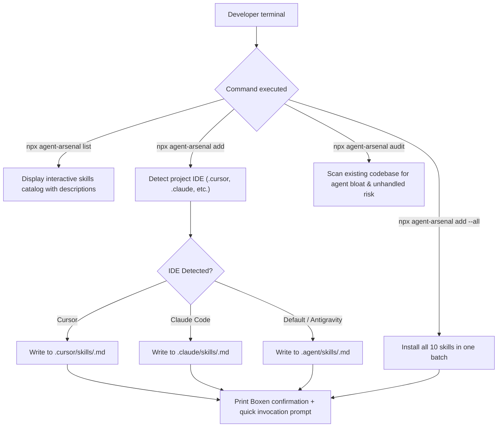

# 🔄 Pillar 3: Application & User Flow (APP FLOW) — Agent Arsenal

## Core User Journeys

---

## State Handling
- **Missing Directory:** Automatically creates target directories recursively (`mkdirSync({ recursive: true })`).
- **Existing File Conflict:** Checks checksum; if modified, alerts user with `--force` overwrite flag guidance.
- **Offline Reliability:** All skill templates are bundled within the package payload. No network drops or GitHub API rate-limiting failure modes.
